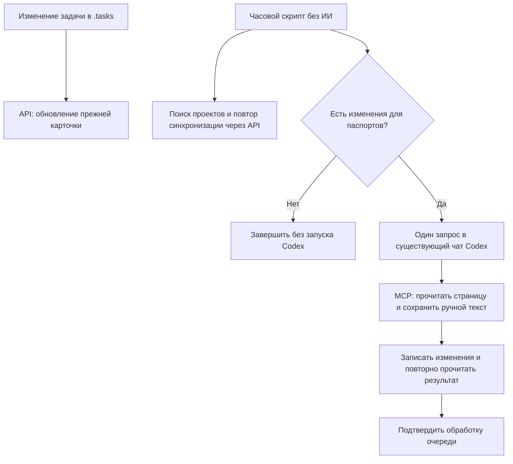

# Система задач для проектов

Общий Hub **v0.6.0**: задачи через API YouGile, паспорта через MCP и запуск Codex только при непустой очереди паспортов.

Готовый навык Codex для установки TaskPlanner в новый или существующий репозиторий. Он добавляет доску задач в Git, правила работы для ИИ-агентов и компактную проектную документацию. YouGile можно подключить отдельно или один раз настроить общий реестр с подключением новых проектов и часовой подстраховкой.

## Что устанавливается

| Часть | Файлы | Назначение |
| --- | --- | --- |
| Доска задач | `.tasks/BACKLOG.md`, `NEXT.md`, `IN_PROGRESS.md`, `DONE.md`, `REJECTED.md` | Задачи и статусы, видимые в Git |
| Настройки и история | `.tasks/config.json`, `.tasks/WORK_LOG.md` | Нумерация задач, приоритеты и журнал завершений |
| Правила для агентов | `AGENTS.md`, `CLAUDE.md`, `.cursorrules` | Единый порядок работы для Codex, Claude и Cursor |
| Контекст проекта | `docs/*.md` | Продукт, архитектура, интеграции, решения, качество и текущая работа |
| Шаблон PR | `.github/pull_request_template.md` | Проверка изменений перед объединением |

TaskPlanner рекомендуется как плагин, но доска состоит из обычных Markdown- и JSON-файлов и работает без него. Шаблон новой доски рассчитан на TaskPlanner `2.1.4`; установленную у вас версию можно передать через `--taskplanner-version`. Существующая доска не перезаписывается и не понижается.

## Установка

Попросите Codex:

```text
Установи навык через $skill-installer из https://github.com/neuro-boss/project-task-system.
Затем используй $project-task-system для текущего проекта.
Сначала покажи план изменений и сохрани существующие задачи, документы и подключения.
```

Затем откройте нужный проект и попросите: «Используй `$project-task-system`, чтобы настроить систему задач в этом репозитории». При желании установите плагин TaskPlanner из каталога Codex для встроенных команд доски.

Можно запустить установщик из клона этого репозитория вручную. Первая команда только показывает план и ничего не записывает:

```bash
python scripts/bootstrap_project.py --target /path/to/project --project-name "Мой проект"
python scripts/bootstrap_project.py --target /path/to/project --project-name "Мой проект" --apply
python scripts/bootstrap_project.py --target /path/to/project --check
```

Существующие задачи и документы сохраняются. Управляемые блоки правил агента обновляются только при явном `--refresh-managed`.

## Общее подключение YouGile для нескольких проектов

Теперь схема входит в сам навык. После однократной настройки:

- при инициализации нового проекта через навык YouGile подключается сразу;
- уже настроенные проекты используют прежние доски, задачи и карты связей;
- после правки задачи агент запускает синхронизацию по правилам проекта;
- раз в час фоновый запуск обнаруживает пропущенные `.tasks`-проекты и повторяет ошибки.

Для этого нужны Python 3.10+, Node.js 20+ и один уже настроенный проект **вашей**
компании YouGile. Ключ хранится в защищённом файле, его не нужно передавать в чат.
Папки, профиль компании и фоновый запуск выбираются при настройке. Подробная
[инструкция общего подключения](references/yougile-hub.md) содержит команды и готовый запрос для Codex.

Обычная установка навыка не создаёт удалённых досок и не включает планировщик.
Часовой Windows-планировщик устанавливается отдельным флагом `--schedule`.
На macOS/Linux подключение при bootstrap работает так же; часовой `tick`
настраивается средствами ОС. Старые ненастроенные проекты остаются исключениями,
а новые проекты подключаются внутри выбранных папок.

## Как работают API, MCP и Codex

| Часть | Что делает | Когда работает |
| --- | --- | --- |
| Локальные `.tasks` | Хранят задачи, статусы и историю; остаются источником задач | При работе над проектом |
| API YouGile | Создаёт и обновляет карточки, статусы, приоритеты, оценки и даты; сохраняет ID и связи | После правки задачи по команде агента и при часовом повторе скрипта |
| Часовой скрипт Hub | Находит новые проекты, синхронизирует задачи, обновляет журнал и проверяет изменения документов | Раз в час, без модели |
| Очередь паспортов | Собирает изменения ссылок и важных сведений из документов проекта | При подключении, синхронизации и часовом запуске |
| Codex | Объединяет новые факты с текущей страницей и ручными дополнениями | Отдельный фоновый запрос — только при непустой очереди |
| MCP YouGile | Читает и записывает страницы базы знаний, затем позволяет проверить сохранённый результат | Во время обработки паспорта |



Например, завершение задачи отражается в карточке через API. Изменение адреса
админки в документации попадает в очередь паспорта: Codex сверяет сведения и
обновляет ту же страницу базы знаний через MCP. Если ничего не изменилось,
часовой скрипт заканчивает проверку без запроса модели.

API использует локальный защищённый ключ. MCP подключается отдельно через OAuth
с разрешением чтения и изменения; для текущей интеграции нужна открытая
авторизованная вкладка YouGile. Сам протокол MCP не требует запуска модели на
каждый вызов: агент используется для смыслового объединения текста.

Настройка MCP и условного запуска включается отдельно. Обычная установка навыка
не выбирает чат и не включает удалённую публикацию. При переходе со старой схемы
безусловный часовой heartbeat Codex приостанавливается; часовой скрипт сохраняется.

Подробности, пример локальных настроек, обработка ошибок и сценарии выбора
API/MCP — [как работает система](references/how-it-works.ru.md).

Запрос для настройки всей связки после установки навыка:

```text
Используй $project-task-system. Настрой общий Hub для моих проектов:
задачи через API YouGile, паспорта через официальный MCP.
Раз в час скрипт должен проверять изменения без ИИ и вызывать Codex
только при непустой очереди паспортов, в выбранном существующем чате.
Сохрани прежние доски, задачи, связи, страницы и ручные дополнения.
Сначала проверь текущие подключения и покажи план; недостающие папки,
профиль компании и чат уточни. Ключи и токены в чат не запрашивай.
```

## Необязательное подключение YouGile

После установки TaskPlanner можно добавить локальную одностороннюю синхронизацию задач в собственную компанию YouGile. Доска `.tasks/*.md` остаётся главным источником; ключ, рабочие ID и карта соответствий хранятся локально вне Git. Установщик не вызывает API и не создаёт удалённые объекты.

```bash
python scripts/bootstrap_yougile.py --target /path/to/project
python scripts/bootstrap_yougile.py --target /path/to/project --apply
python scripts/bootstrap_yougile.py --target /path/to/project --check
```

Дальше следуйте [инструкции подключения YouGile](references/yougile.md). Для передачи другому ИИ есть [готовый промпт на русском](references/yougile-prompt.ru.txt). Ключ своей компании нельзя отправлять в чат или добавлять в репозиторий. Этот отдельный установщик не включает фон; для общего реестра используйте [схему выше](#общее-подключение-yougile-для-нескольких-проектов).

## Журнал работы, отчёты и паспорта

Общий Hub формирует отчёты за день, календарную неделю, месяц или произвольные
даты: по одному либо всем зарегистрированным проектам, включая проекты без YouGile.
История берётся из WORK_LOG и дат Completed; новые изменения фиксируются при
синхронизации и часовом запуске. Для исследований/решений есть отдельные короткие
заметки. Время обнаружения не выдаётся за время выполнения, оценки — за фактические часы.

Отчёт сохраняется в Markdown/JSON и как локальный HTML: выбор проекта и дат,
поиск, результаты и подтверждения. Часовой запуск обновляет последний обзор без
накопления часовых архивов; отчёт по запросу сохраняет отдельный снимок.

Описания задач Hub преобразует из Markdown в безопасный HTML: абзацы, списки,
выделения, ссылки, код и таблицы. Исходные задачи и существующие ID сохраняются.
При подключении нового проекта Hub создаёт паспорт `docs/project-passport.md`.
Изменения важных документов попадают в очередь при синхронизации и раз в час.
С разрешения пользователя агент обновляет ту же страницу базы знаний YouGile,
сохраняя ручные дополнения; часовой скрипт вызывает Codex только при непустой очереди.
Публикация выполняется через MCP YouGile с OAuth; нужна открытая авторизованная вкладка YouGile. Windows tick сам страницы
не публикует. Без изменений лишней записи нет. Локальный HTML-экспорт сохранён.

[Команды и границы отчётности](references/activity-reports.md).

## Проверка и безопасность

Установщики сначала показывают изменения и сохраняют существующие пользовательские файлы. Перед публикацией своего проекта проверьте, что локальные настройки и ключи не отслеживаются Git. Тесты этого репозитория:

```bash
python -m unittest discover -s scripts
node --test assets/yougile/taskplanner-yougile-core.test.mjs assets/project-task-hub/test/hub.test.mjs assets/project-task-hub/test/onboarding.test.mjs assets/project-task-hub/test/markdown.test.mjs assets/project-task-hub/test/activity.test.mjs assets/project-task-hub/test/passport.test.mjs assets/project-task-hub/test/passport-mcp.test.mjs assets/project-task-hub/test/passport-wake.test.mjs
```

## Лицензия

MIT
